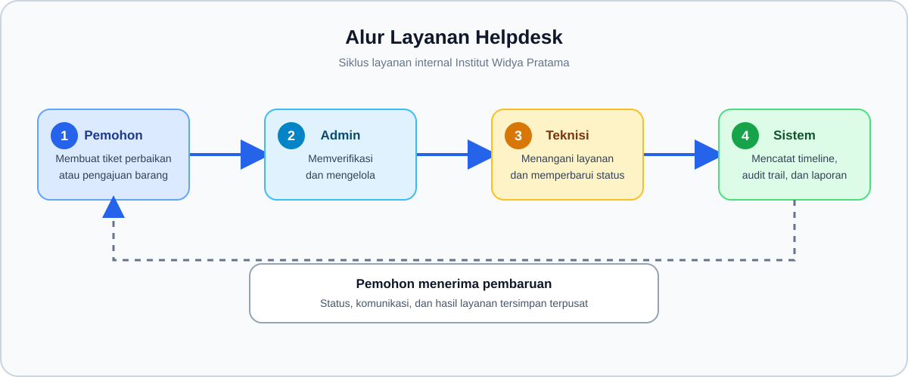

<p>
    
</p>

# Helpdesk System

Platform layanan helpdesk untuk mengelola permintaan bantuan, tiket perbaikan, penugasan teknisi, monitoring aktivitas, dan pelaporan layanan dalam satu sistem terintegrasi.

Sistem ini dirancang untuk mempercepat alur layanan dari pelaporan pengguna sampai penyelesaian oleh teknisi, sekaligus menyediakan histori aktivitas dan laporan yang dapat diekspor.

# Konteks Proyek

Helpdesk System merupakan implementasi Sistem Informasi Manajemen Pelayanan Internal untuk mendukung Bidang Pelayanan dan Perawatan Infrastruktur Institut Widya Pratama, Kota Pekalongan.

Sistem dibuat untuk menggantikan pencatatan layanan yang sebelumnya tersebar pada dokumen terpisah. Fokus implementasinya adalah mengintegrasikan pelayanan Tiket Perbaikan, Pengajuan Barang, aktivitas teknisi, komunikasi melalui timeline, audit trail, serta pengukuran durasi layanan dalam satu platform web.

## Ruang Lingkup

- **Tiket Perbaikan:** pelaporan kerusakan, penanganan teknisi, pembaruan status, dan penyelesaian layanan.
- **Pengajuan Barang:** pengajuan kebutuhan perangkat atau barang, proses evaluasi, komunikasi, dan keputusan akhir.
- **Kegiatan Teknisi:** pencatatan aktivitas harian sebagai dokumentasi pekerjaan.
- **Timeline dan audit trail:** riwayat perubahan status serta komunikasi antar pengguna.
- **Monitoring dan laporan:** rekapitulasi layanan, durasi pengerjaan, indikator SLA, dan ekspor dokumen.

Sistem ini berdiri sendiri dan pada tahap saat ini tidak mencakup integrasi API dengan sistem eksternal.

## Gambaran Sistem

<p>
    
</p>

## Fitur Utama

- Manajemen tiket perbaikan layanan.
- Pengajuan barang dengan nama yang diketik langsung, kategori pada pengajuan, jumlah, spesifikasi, alasan, dan histori proses. Referensi barang dapat berupa unggahan gambar atau tautan produk.
- Penugasan serta pencatatan kegiatan teknisi.
- Monitoring log pengajuan dan log perbaikan.
- Laporan kegiatan, perbaikan, dan permintaan barang.
- Ekspor laporan ke Excel, PDF, dan Word.
- Notifikasi database dan pembaruan realtime menggunakan Laravel Reverb.
- Profil pengguna untuk mengubah data pribadi dan password.
- Reset password melalui email.
- Manajemen pengguna dan role berbasis permission.
- Filter data berdasarkan status, tanggal, kategori, dan kebutuhan operasional.

## Pembaruan Sistem Terbaru

- Form pengajuan barang tidak lagi memilih barang dari master barang. Nama barang diisi langsung, sedangkan kategori tetap dipilih dari kategori yang tersedia. Perubahan struktur ini diterapkan melalui migrasi database.
- Referensi contoh barang menjadi satu bagian form dengan pilihan unggah gambar atau memasukkan tautan. Unggahan menerima JPEG, PNG, dan WebP hingga 5 MB.
- Tombol **Create & create another** disembunyikan pada form create. Form dan fungsi pembuatan data tetap tersedia.
- Dashboard pemohon, teknisi, dan admin dirapikan sesuai kebutuhan tiap role. Grafik tren menampilkan pesan saat tidak ada layanan dalam periode terpilih.
- Akses pemohon tanpa login belum menjadi fitur; pemohon tetap menggunakan panel dan autentikasi yang tersedia.

## Role Pengguna

| Role            | Panel        | Akses utama                                                                       |
| --------------- | ------------ | --------------------------------------------------------------------------------- |
| `pemohon`     | `/pemohon` | Membuat dan memantau tiket perbaikan serta pengajuan barang miliknya sendiri.     |
| `teknisi`     | `/admin`   | Melihat dan menangani tiket, memperbarui proses, serta mencatat kegiatan teknisi. |
| `admin`       | `/admin`   | Mengelola layanan, pengguna, ruangan, monitoring, dan laporan operasional.        |
| `super_admin` | `/admin`   | Akses administratif penuh, termasuk pengelolaan role dan permission.              |

## Teknologi

- PHP 8.3
- Laravel 13
- Filament 5
- Livewire 4
- MySQL
- Laravel Reverb dan Laravel Echo untuk realtime event
- Spatie Laravel Permission untuk role dan permission
- Laravel Excel untuk ekspor spreadsheet
- DomPDF dan PHPWord untuk dokumen laporan
- Vite dan Tailwind CSS 4 untuk asset frontend

## Persyaratan

- PHP 8.3 atau lebih baru
- Composer
- Node.js dan npm
- MySQL/MariaDB
- Ekstensi PHP yang dibutuhkan Laravel dan koneksi database

## Instalasi Lokal

Clone repository lalu masuk ke folder proyek:

```bash
git clone https://github.com/MuhammadAlifMafaza/helpdesk.git
cd helpdesk
```

Install dependency dan siapkan environment:

```bash
composer install
cp .env.example .env
php artisan key:generate
```

Atur koneksi database pada `.env`, kemudian jalankan migrasi:

```bash
php artisan migrate
```

Install dan build asset frontend:

```bash
npm install
npm run build
```

## Konfigurasi Environment

Contoh konfigurasi database:

```dotenv
DB_CONNECTION=mysql
DB_HOST=127.0.0.1
DB_PORT=3306
DB_DATABASE=helpdesk_db
DB_USERNAME=root
DB_PASSWORD=
```

Untuk pengembangan tanpa email sungguhan, gunakan mailer log:

```dotenv
MAIL_MAILER=log
```

Link reset password dapat dibaca pada `storage/logs/laravel.log`. Untuk mengirim email sungguhan, ganti `MAIL_MAILER` dengan konfigurasi SMTP yang valid.

## Menjalankan Aplikasi

Mode development utama:

```bash
composer run dev
```

Perintah tersebut menjalankan server Laravel, queue listener, Laravel Reverb, dan Vite secara bersamaan.

Alternatif menjalankan server web dan Vite secara terpisah:

```bash
php artisan serve
npm run dev
```

Pada mode terpisah, jalankan `php artisan queue:listen --tries=1` untuk memproses queue dan `php artisan reverb:start` jika membutuhkan pembaruan realtime.

Panel aplikasi tersedia pada:

- Admin: `http://localhost:8000/admin`
- Pemohon: `http://localhost:8000/pemohon`

Sesuaikan URL dengan nilai `APP_URL` dan konfigurasi web server lokal yang digunakan.

## Struktur Folder Utama

```text
app/
|-- Broadcasting/       # Channel realtime
|-- Events/             # Event aktivitas helpdesk
|-- Exports/            # Export laporan
|-- Filament/           # Panel, resource, page, widget, dan exporter
|-- Http/               # Controller dan middleware
|-- Models/             # Model user dan domain helpdesk
|-- Notifications/      # Notifikasi aplikasi
`-- Services/           # Layanan notifikasi dan generator laporan

database/
|-- factories/          # Factory untuk pengujian dan data awal
|-- migrations/         # Struktur database
`-- seeders/            # Data awal aplikasi

resources/
|-- css/                # Style frontend
|-- js/                 # Echo dan integrasi JavaScript
`-- views/              # Blade views
```

## Keamanan

- Akses panel dibatasi berdasarkan role pengguna.
- Data pemohon dibatasi pada tiket dan pengajuan miliknya sendiri.
- Password disimpan menggunakan hashing Laravel.
- Reset password menggunakan token dengan masa berlaku terbatas.
- Permission resource dikelola dengan Filament Shield dan Spatie Permission.
- Jangan memasukkan kredensial SMTP, `APP_KEY`, atau secret Reverb ke repository.

## Penggunaan Institusional

Sistem ini ditujukan untuk mendukung operasional internal Institut Widya Pratama, khususnya Bidang Pelayanan dan Perawatan Infrastruktur. Ketentuan penggunaan produksi, pemeliharaan, akses source code, serta kebijakan internal institusi mengikuti keputusan resmi pihak yang berwenang.

## Pengujian

Project menggunakan PHPUnit dengan suite `Unit` dan `Feature` yang dikonfigurasi di `phpunit.xml`. Saat ini test otomatis yang tersedia berada di `tests/Feature`; direktori `tests/Unit` belum berisi file test.

Feature test mencakup autentikasi dan reset password, input serta resource pengajuan barang, dashboard dan aksi form, notifikasi realtime, laporan/cetak dokumen, kegiatan teknisi, role, dan seeder.

Jalankan seluruh test suite:

```bash
php artisan test --compact
```

Jalankan feature test saja:

```bash
vendor/bin/phpunit --testsuite Feature
```

## Status Dokumentasi

Dokumentasi sistem didukung oleh:

- Laporan Magang di Unit Teknisi dan Perawatan Infrastruktur Institut Widya Pratama.
- Proposal Tugas Akhir berjudul _Implementasi Sistem Informasi Manajemen Pelayanan Internal (Helpdesk) pada Bidang Pelayanan dan Perawatan Infrastruktur di Institut Widya Pratama_.
- Manual Book System.

Dokumen tersebut menjadi referensi konteks bisnis, alur proses, kebutuhan sistem, desain database, dan rancangan implementasi. Detail regulasi penggunaan produksi tetap mengikuti keputusan resmi institusi.

## Hasil Uji Beban

Pengujian dilakukan secara lokal melalui Laragon Apache menggunakan database uji terisolasi. Skenario mencakup alur pemohon dan admin, termasuk melihat daftar layanan, membuat pengajuan/tiket, mengirim pesan, dan memperbarui status. Beban dinaikkan bertahap hingga 50 virtual users (VU), lalu dijalankan sekitar 4 menit 20 detik.

| Metrik                         |                    Hasil |
| ------------------------------ | -----------------------: |
| Request HTTP                   |                   11.136 |
| Kegagalan HTTP                 |                       0% |
| Pemeriksaan respons            | 17.748 / 17.748 berhasil |
| Durasi request p95 keseluruhan |               1,59 detik |
| Durasi request maksimum        |               8,33 detik |
| Beban puncak yang diuji        |                    50 VU |

Dua perjalanan daftar pengajuan memiliki p95 di atas sasaran 2 detik:

| Perjalanan               |        p95 |
| ------------------------ | ---------: |
| Daftar pengajuan pemohon | 2,01 detik |
| Daftar pengajuan admin   | 2,14 detik |

Sasaran p95 keseluruhan di bawah 2 detik tercapai, tetapi waktu respons kedua daftar pengajuan tersebut masih perlu diperhatikan. Pada sampel 50 VU, sekitar 50 worker PHP-FCGI menggunakan working set agregat kurang lebih 3,82 GiB. Angka penggunaan memori ini bergantung pada lingkungan pengujian.

Pengujian belum mengukur titik overload karena beban maksimum yang dicoba adalah 50 VU. Karena itu, kapasitas di atas 50 VU belum dapat dipastikan; kisaran 50–60 VU hanya dapat dipakai sebagai sasaran uji lanjutan, bukan kapasitas terjamin atau hasil pengukuran. Hasil ini merupakan benchmark lokal dan tidak menjamin performa pada lingkungan produksi.

## Lisensi

Proyek ini menggunakan **MIT License**. Teks lisensi lengkap tersedia pada [LICENSE](LICENSE). Penggunaan di lingkungan institusi tetap harus mengikuti kebijakan resmi Institut Widya Pratama.
